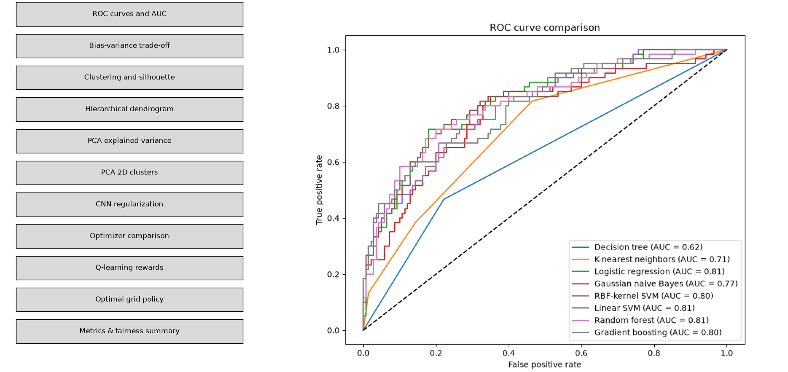
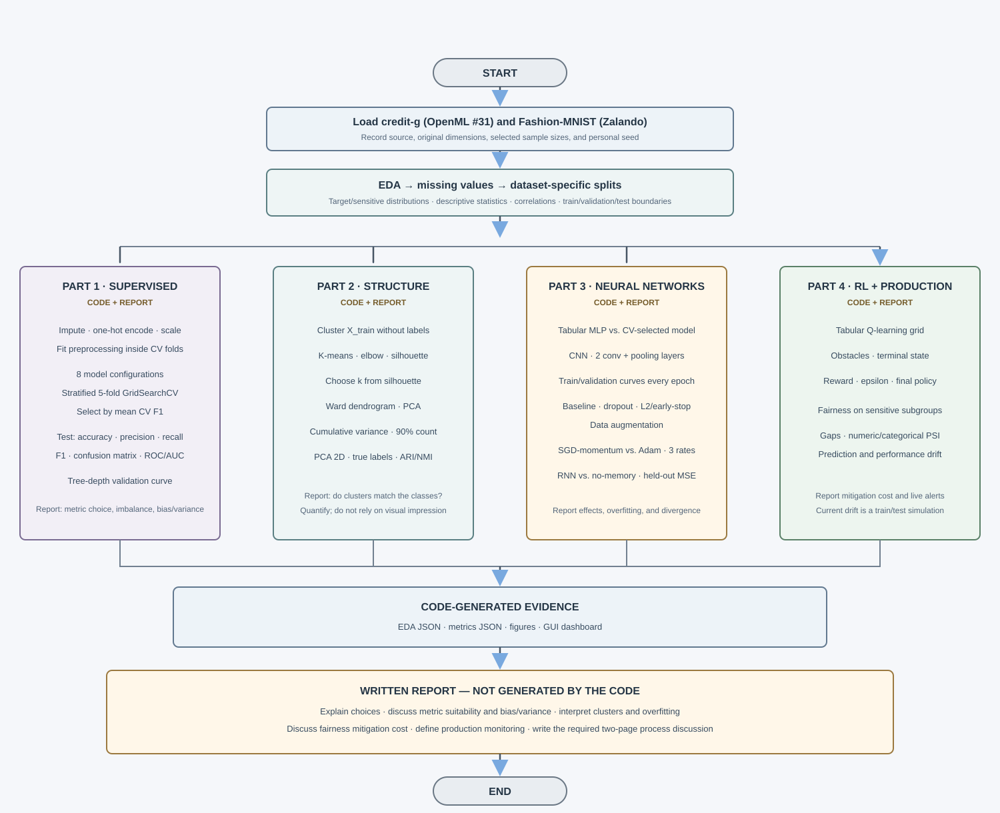
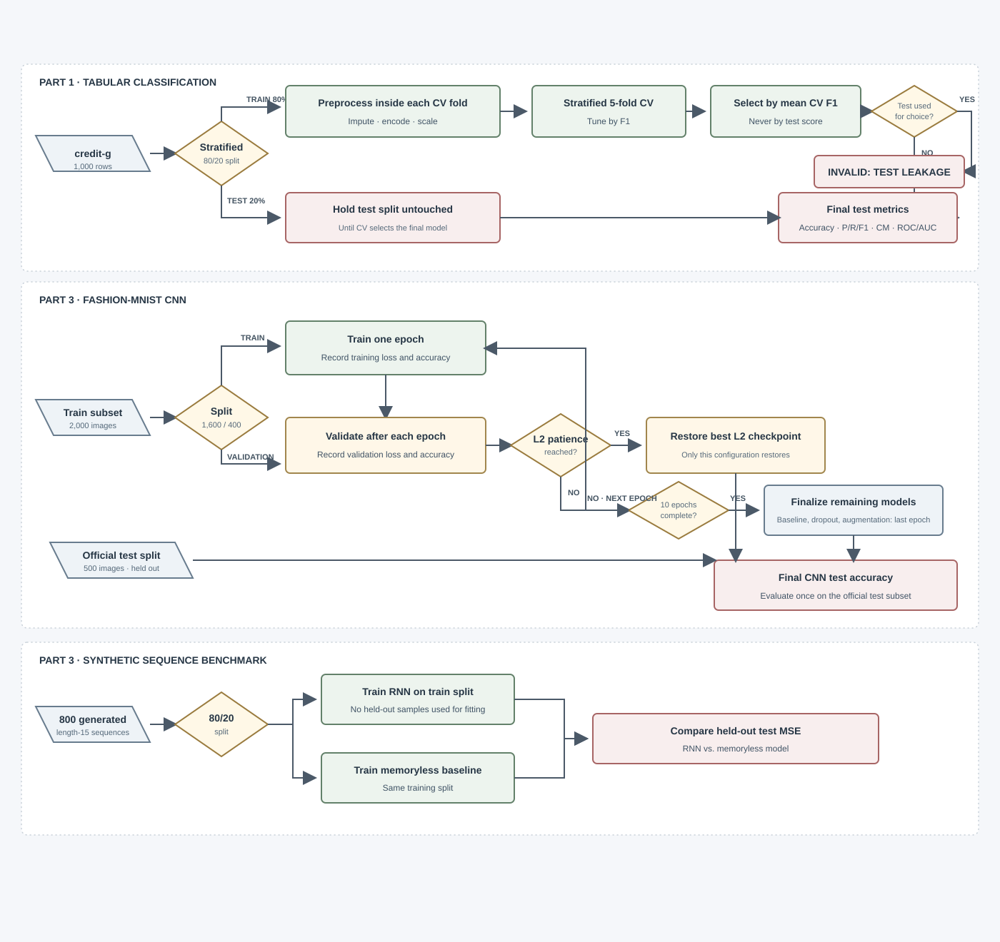

# From Predictive Modeling to Deep Learning

A university machine learning project covering supervised learning, unsupervised pattern recognition, neural networks, reinforcement learning, fairness analysis, and drift monitoring. It uses scikit-learn and PyTorch.

<br>
<p align="center">
  
</p>
<br>
<div align="center">
  
  
  
</div>

---

```text
Predictive-to-Deep-Learning/
├── main.py
├── README.md
├── requirements.txt
├── data/
├── images/
│   └── diagrams/
│       ├── assignment-flowchart.svg
│       └── evaluation-flowchart.svg
├── outputs/
│   ├── figures/
│   └── models/
└── src/
    ├── config.py
    ├── data_loader.py
    ├── neural_networks.py
    ├── reinforcement_fairness.py
    ├── supervised.py
    └── unsupervised.py
```

## Run the project

Use a [Python 3.14](https://www.python.org/downloads/release/python-3140/)+.

```powershell
git clone https://github.com/iamkhin-dev/predictive-to-deep-learning
cd Predictive-to-Deep-Learning
```
Install `requirements.txt`

```powershell
pip install -r requirements.txt
```

Run the project

```powershell
python main.py 
```

## Assignment logic



## Evaluation protocol




## Datasets

| Dataset | Source | Original size | Project sample |
| --- | --- | ---: | ---: |
| German Credit (`credit-g`) | [OpenML dataset 31](https://www.openml.org/d/31) | 1,000 rows, 20 predictors and 1 target | All 1,000 rows; stratified 80/20 train/test split |
| Fashion-MNIST | [Zalando Research](https://github.com/zalandoresearch/fashion-mnist)| 60,000 training and 10,000 test images, grayscale 28 × 28, 10 classes | 2,000 selected from the training set, split into 1,600 train and 400 validation; 500 selected from the official test set |
| Synthetic sequence benchmark | Generated | 800 sequences of length 15 | 80/20 train/test split |

The tabular target is encoded as `good = 0` and `bad = 1`. The selected positive class is therefore the bad-credit class. The current default seed is `42` in `src/config.py`; replace it with the personal seed required for your submission.

Dataset metadata and exploratory outputs are written to `outputs/eda_report.json`. The report includes sources, dimensions, split sizes, missing-value counts, descriptive statistics, target and sensitive-attribute distributions, and numeric correlations. Fashion-MNIST source and subset sizes are recorded in the same report.


## Experiments

### Supervised learning

The tabular preprocessing is part of each scikit-learn pipeline: numeric columns use median imputation and standardization; categorical columns use most-frequent imputation and one-hot encoding. The preprocessing is fitted within the training folds by `GridSearchCV`.

Eight classical estimators are compared:

| Model | Hyperparameters |
| --- | --- |
| Decision Tree | `max_depth` |
| K-Nearest Neighbors | `n_neighbors` |
| Logistic Regression | `C` |
| Gaussian Naive Bayes | — |
| SVM (RBF kernel) | `C`, `gamma` |
| SVM (Linear kernel) | `C` |
| Random Forest | `n_estimators`, `max_depth` |
| Gradient Boosting | `n_estimators`, `learning_rate` |


Hyperparameters are chosen using stratified five- cross-validation on the training split with F1. The final classical model is picked based on its validation F1, not, on its test score.
The reported test metrics are accuracy, precision, recall, F1, confusion matrix and ROC AUC. A decision tree validation curve changes depth to show the bias and variance trade-off. The tabular MLP uses the train and test split and shows the same classification metrics.

### Unsupervised learning and PCA

K-means is evaluated for `k = 2..10`; the selected `k` is the one with the highest silhouette coefficient, while the elbow curve is provided as an additional diagnostic. A Ward hierarchical dendrogram is built from a 100-row training sample. PCA reports cumulative explained variance and the number of components required to reach 90%; a two-dimensional projection is colored by true labels and by K-means assignments. ARI and NMI quantify agreement between clusters and labels after clustering.

### Neural networks

The image CNN contains two convolutional layers and two max-pooling layers. Training and validation curves are generated for four configurations:

| Configuration | Regularization strategy |
| --- | --- |
| Baseline | None |
| Dropout | Dropout 0.5 on the FC layer |
| L2 + Early Stopping | Weight decay `1e-3`, patience 3 |
| Data Augmentation | Affine rotations and translations |

Early stopping and best-checkpoint restoration are limited to the L2 configuration so the baseline and dropout curves can expose overfitting. The 500-image test subset is kept separate for final accuracy measurement.

The optimizer experiment compares SGD with momentum and Adam at learning rates `0.5`, `0.01`, and `0.0005`. Non-finite losses are masked in the log-scale plot. The sequence experiment compares an RNN with a memoryless feed-forward model using a held-out test split and test MSE.

### Reinforcement learning, fairness, and drift


I run tabular Q‑learning in a 5 × 5 grid that contains obstacles and a terminal goal.
The reward curves compare epsilon values 0.01, 0.1 and 0.5.
The policy that results from this comparison is shown on the grid.
I read the fairness audit. It lists group size, accuracy, recall and selection rate for the personal_status attribute.
It also lists recall, selection‑rate and accuracy gaps, well as a disparate‑impact ratio.
Because class 1 stands for credit the selection rate shown here is the rate of predictions that choose the bad‑credit class.
Look at it with that in mind.
If a sensitive‑attribute value is missing that group is reported by itself.
I look at drift outputs, which contain PSI for features PSI for categorical features PSI for predictions and changes in accuracy and F1 score when labels are supplied.
The current `main.py` compares the training split with the held‑out test split, as a simulation.
This is not a production monitor.
Production monitoring needs inputs from production and for performance drift it needs labels when they become available.


## Code and written report

The code produces the experiments and quantitative evidence. The report must interpret that evidence and explain the methodological choices; generated figures and metrics do not replace that discussion.

| Assignment requirement | Code evidence | Written report responsibility |
| --- | --- | --- |
| EDA, data source, dimensions, and split | `eda_report.json` and EDA figures | Describe dataset suitability and initial findings |
| Personal-seed train/test split | Stratified tabular split and seeded image/sequence splits | State the personal seed and explain the split protocol |
| Missing-value handling, categorical encoding, and normalization | Imputation, one-hot encoding, scaling inside the scikit-learn pipeline | Explain why transformations are fitted only on training folds |
| At least five model families, including two SVM kernels | Eight estimators: tree, KNN, logistic regression, naive Bayes, RBF/linear SVM, random forest, gradient boosting | Show five-fold CV evidence and explain why test data must not select hyperparameters |
| Classification metrics and ROC/AUC | Test metrics and ROC figure | Justify the useful metric and explain accuracy under class imbalance |
| Validation curve | Decision-tree depth curve | Interpret the bias/variance trade-off |
| Clusters, PCA, ARI, and NMI | Clustering/PCA figures and scores | Answer whether unlabeled clusters match classes, using the scores |
| MLP and CNN comparisons | MLP metrics, CNN curves and test accuracy | Compare the MLP with the CV-selected classical model; explain overfitting and each CNN remedy |
| Optimizers and sequence benchmark | Learning-rate curves and held-out sequence MSE | Discuss divergence at a large learning rate and the sequence result |
| Q-learning, fairness, and drift | Reward/policy figures, subgroup gaps, PSI metrics | Interpret the policy and subgroup gap; discuss mitigation and its cost in overall accuracy |
| Post-release monitoring | Simulated feature, prediction, and performance drift | Propose production signals, thresholds, alerts, and responses when the model degrades |
| Process discussion | Not generated by the code | Write the required two-page process discussion |


## Output files

| Path | Contents |
| --- | --- |
| `outputs/eda_report.json` | Dataset metadata and tabular EDA |
| `outputs/metrics_report.json` | Model, clustering, CNN, sequence, fairness, and drift metrics |
| `outputs/figures/` | ROC, validation, clustering, PCA, CNN, optimizer, Q-learning, and EDA figures |

The current run does not serialize trained model weights. Figures and reports are regenerated when `main.py` runs.


## Implementation notes

- `src/data_loader.py` loads both datasets, creates the image splits, and writes the EDA report and figures.
- `src/supervised.py` builds the preprocessing/model pipelines and cross-validation experiments.
- `src/unsupervised.py` runs K-means, hierarchical clustering, and PCA.
- `src/neural_networks.py` trains the tabular MLP, image CNN experiments, optimizer comparison, and sequence benchmark.
- `src/reinforcement_fairness.py` contains the grid-world agent, subgroup audit, and drift metrics.
- `main.py` coordinates the run, saves `metrics_report.json`, and opens the plot dashboard.
